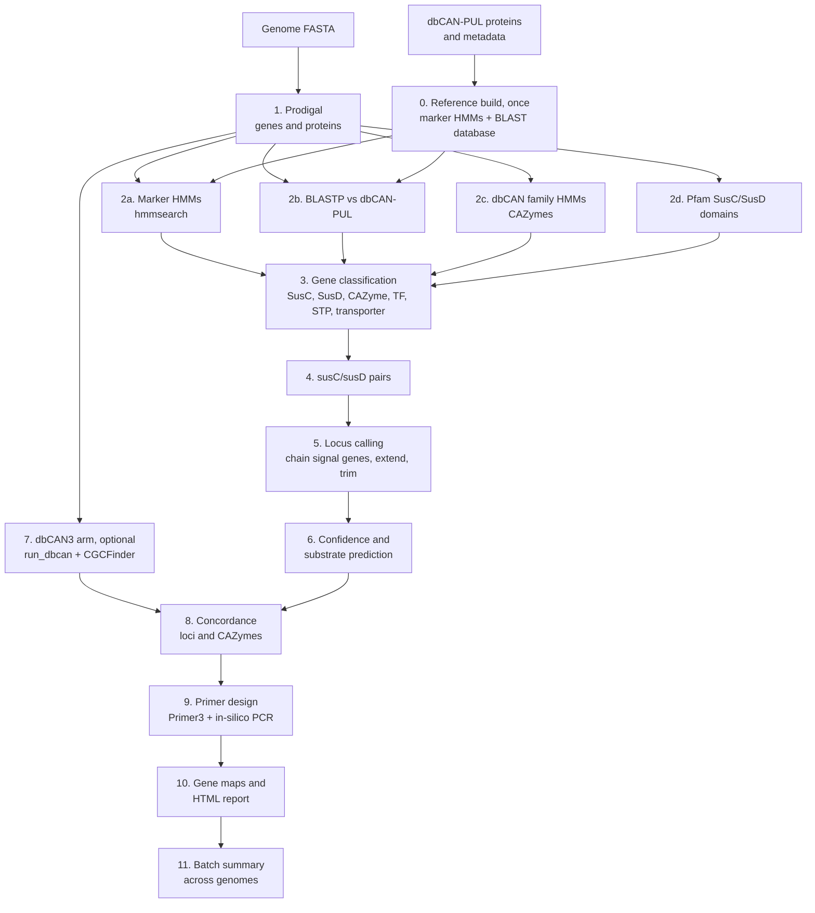

# Workflow and core idea

## Core idea

A polysaccharide utilization locus (PUL) in Bacteroidota is defined by
genomic context, not by any single gene: a **susC/susD pair** (a
TonB-dependent outer-membrane transporter next to its glycan-binding
lipoprotein) sits beside the **CAZymes** that degrade one glycan, usually
with a regulator.

PULseHunter therefore works in three layers:

1. **Evidence per gene.** Every gene is tested against several independent
   sources: marker HMMs built from experimentally characterised PULs
   (dbCAN-PUL), direct homology to dbCAN-PUL proteins, CAZy family HMMs
   (dbCAN) and Pfam SusC/SusD domains.
2. **Context.** susC/susD pairs are the anchors. Loci are grown from the
   pairs and from degradative CAZymes, with limits on distance, so that
   neighbouring PULs are not merged and scattered CAZymes are not called
   PULs.
3. **Interpretation.** Each locus gets a confidence level from its gene
   content, a substrate transferred from the best-matching characterised
   PUL (with an explicit support level), an independent second opinion
   from dbCAN3, and primers that are checked for specificity.

The result for each locus is something that can be taken to the bench: a
gene map, sequences, a substrate hypothesis and tested primer sets.

## Workflow

## Core steps

### 0. Reference build (once)

Scripts: `prepare_reference_db.py`, `build_marker_hmms_from_headers.py`

- The dbCAN-PUL protein headers
  (`id:PUL:gene:locus:accession:class:annotation`) are parsed into a table
  and joined to the metadata (substrate, organism, verification method).
- Proteins are grouped by class and annotation (SusC, SusD, CAZyme
  families, TF, STP, TC). Each group with at least `--min-seed-size`
  sequences is aligned with MAFFT and turned into a profile HMM with
  `hmmbuild` (about 130 marker HMMs).
- All dbCAN-PUL proteins are formatted as a BLAST database.
- The SusC/SusD Pfam families are extracted from `Pfam-A.hmm` into a small
  HMM file.

The reference directory is marked with `REFERENCE_READY` and reused by
every later run.

### 1. Gene prediction

Prodigal predicts genes on the genome (`single` mode for isolates, `meta`
for fragmented assemblies). Both arms use these same genes, so their
results can be compared gene by gene.

### 2. Evidence searches

| Search | Tool | Gives |
|---|---|---|
| Marker HMMs | `hmmsearch` | Class of the gene by similarity to characterised PUL proteins |
| dbCAN-PUL proteins | `blastp` | Closest characterised PUL protein, its PUL and substrate |
| dbCAN family HMMs | `hmmsearch` | CAZy family (GH, PL, CE, CBM, GT, AA) |
| Pfam SusC/SusD | `hmmsearch` | TonB-dependent receptor domains (PF00593, PF07715, PF13715, PF07660) and SusD families (PF07980, PF12741, PF12771, PF14322) |

### 3. Gene classification

Script: `call_puls_hmm.py`

| Class | Evidence (any of) |
|---|---|
| SusC-like | Pfam plug + barrel domains; SusC marker HMM; dbCAN-PUL homolog of transporter class 1.B.14 |
| SusD-like | Pfam SusD family; SusD marker HMM; dbCAN-PUL homolog of class 8.A.46 |
| CAZyme | dbCAN family HMM (i-Evalue <= 1e-15, coverage >= 0.35); CAZyme marker HMM; dbCAN-PUL CAZyme homolog (>= 30 % identity, >= 50 % query coverage) |
| TF, STP, transporter | Marker HMMs and dbCAN-PUL homologs |

Degradative CAZymes are GH, PL, CE, CBM and AA. Glycosyltransferases (GT)
build glycans rather than degrade them, so they count only as supporting
evidence.

### 4. susC/susD pairs

A SusC-like and a SusD-like gene form a pair when they are on the same
strand and at most one gene apart. A TonB-dependent transporter without a
SusD partner is **not** treated as SusC: Bacteroides genomes carry many
TonB-dependent transporters for iron, vitamin B12 and other substrates.

### 5. Locus calling

- **Strong signal genes**: members of a susC/susD pair, SusD-like genes
  and degradative CAZymes.
- **Supporting genes**: regulators (TF, STP), other transporters, GTs.
- Two strong signal genes are chained into one locus when they are at
  most 4 genes apart, at most 2 of the genes between them carry no signal
  at all, and they are at most 10 kb apart. All three conditions must
  hold.
- A locus is extended over up to 3 directly adjacent supporting genes at
  each edge, so that the regulator belongs to the locus.

### 6. Confidence and substrate

Confidence:

| Level | `pul_type` | Rule |
|---|---|---|
| high | `canonical_SusCD_PUL` | at least one susC/susD pair and at least one degradative CAZyme |
| medium | `SusCD_only` | a susC/susD pair without CAZyme |
| medium | `incomplete_SusCD_PUL` | no pair, but a SusD-like gene or TonB-dependent transporter with at least 2 CAZymes |
| low | `CAZyme_cluster` | at least 2 CAZymes with a regulator or transporter, no SusC/SusD |

Anything weaker is not reported.

Substrate: every dbCAN-PUL entry is scored by the summed best bitscore of
the locus genes that hit it. The best-scoring PUL gives the predicted
substrate, with a support level:

| Support | Rule |
|---|---|
| strong | at least 3 locus genes match, at least 50 % of the reference PUL is recovered, mean identity at least 50 % |
| moderate | at least 2 genes match, at least 25 % of the reference PUL recovered |
| weak | anything less; a hint only |

### 7. dbCAN3 arm (optional)

`run_dbcan` is run in protein mode on the Prodigal proteins with HMMER and
DIAMOND, and CGCFinder calls CAZyme gene clusters (CGCs) from CAZymes,
transporters and regulators. This is an independent, widely used method
that does not require a susC/susD pair.

### 8. Concordance

Script: `integrate_dbcan.py`

- **Loci**: each PULseHunter locus is compared with the CGCs by shared
  genes and labelled `both` or `PULseHunter_only`; CGCs without a
  PULseHunter locus are listed as `dbCAN3_only`.
- **CAZymes**: each CAZyme call is labelled as found by both methods or
  only one.

How to read the categories:

| Category | Typical content |
|---|---|
| both | Canonical PULs; the most reliable calls |
| PULseHunter only | susC/susD pairs with few or no annotated CAZymes, for example host-glycan or uncharacterised PULs |
| dbCAN3 only | CAZyme clusters without a susC/susD pair, for example Gram-positive type loci, glycosyltransferase and capsule clusters |

### 9. Primer design

Script: `design_primers.py`

1. Marker genes of the locus are ranked: susC, then susD, then CAZymes.
2. Primer3 proposes pairs (18 to 24 nt, Tm about 60 °C, 40 to 60 % GC,
   Tm difference at most 2 °C, hairpin and dimer limits).
   `qpcr` mode: 80 to 200 bp inside a marker gene. `pcr` mode: 400 to
   1000 bp across the susC/susD junction.
3. **In-silico PCR.** A primer is predicted to prime wherever its
   3'-terminal 10 bases match exactly with at most 3 mismatches in the
   rest. Products are counted in the target genome and in every
   off-target genome (`--offtarget-fasta`, or the other genomes of the
   batch with `--community-specificity`).
4. The best non-overlapping sets (default 3) are reported, ranked by
   specificity, marker priority and Primer3 penalty. A set is `specific`
   when it gives exactly one product in the target genome and none
   elsewhere.

### 10. Figures and report

Scripts: `plot_puls.py`, `make_report.py`

- One gene map per locus: genes drawn to scale as arrows, coloured by
  class and labelled with their family, a track with the overlapping
  dbCAN3 CGCs and a track with the primer amplicons.
- A genome overview showing where the loci lie, shaded by confidence.
- One self-contained HTML report per genome.

### 11. Batch summary

Script: `summarize_batch.py`

Combines all genomes into joint tables, three summary figures (loci per
genome by confidence, PULseHunter versus dbCAN3, substrates per genome)
and an `index.html` linking to every genome report.

## Limits

- The susC/susD model is specific to Bacteroidota. In other phyla only
  `CAZyme_cluster` loci and the dbCAN3 arm are informative.
- Substrate prediction is transfer by homology and depends on what is in
  dbCAN-PUL. Novel PULs get `weak` or no support.
- Tandem PULs that lie within the chaining distance are reported as one
  locus (`susCD_pairs` greater than 1 is a hint).
- Loci at contig ends (`at_contig_edge`) may be incomplete.
- Primer specificity is predicted against the genomes supplied; it says
  nothing about organisms that were not included.
